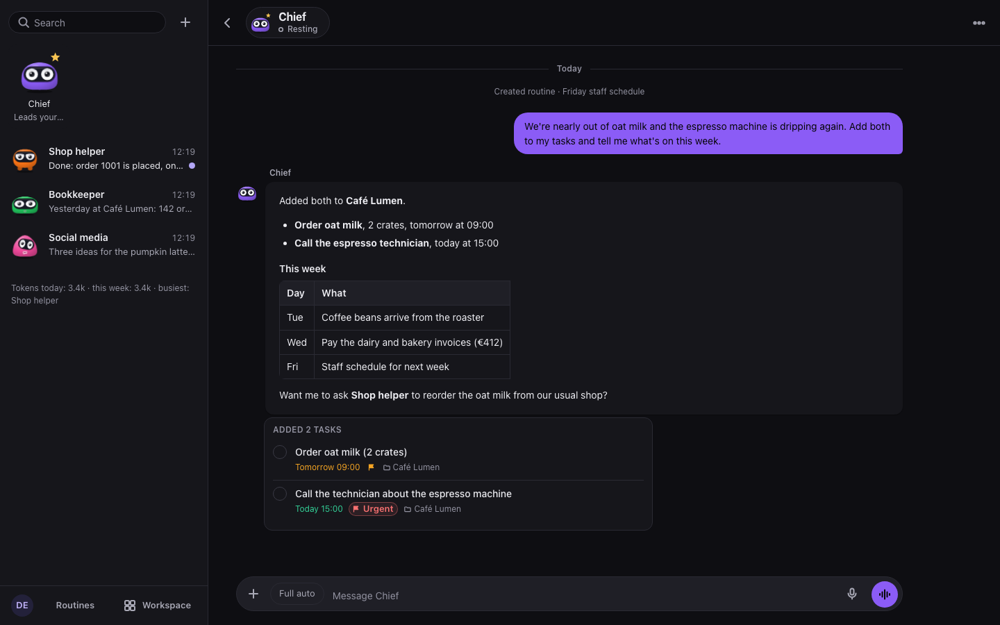
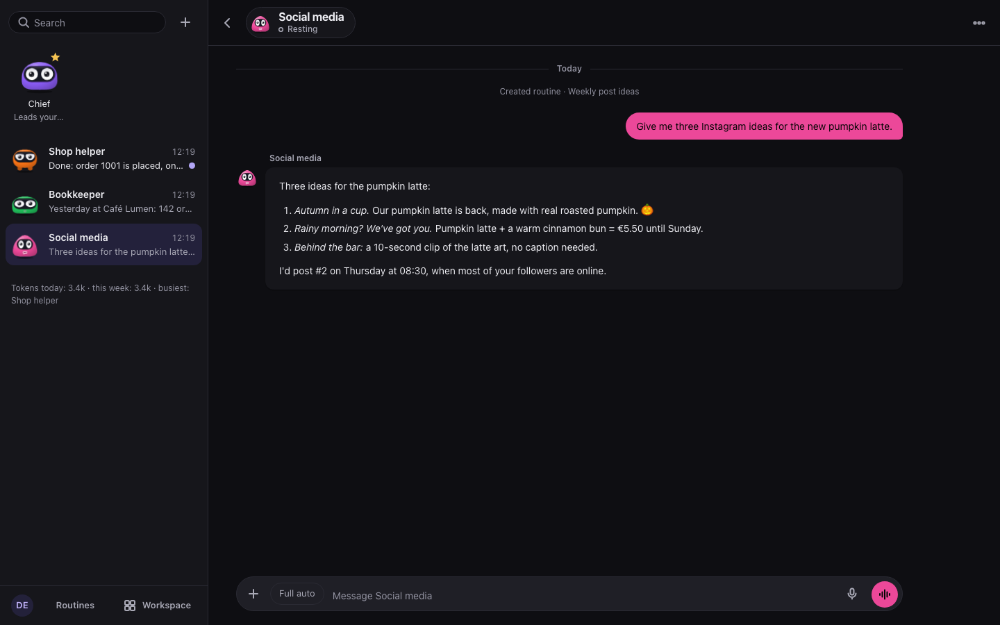
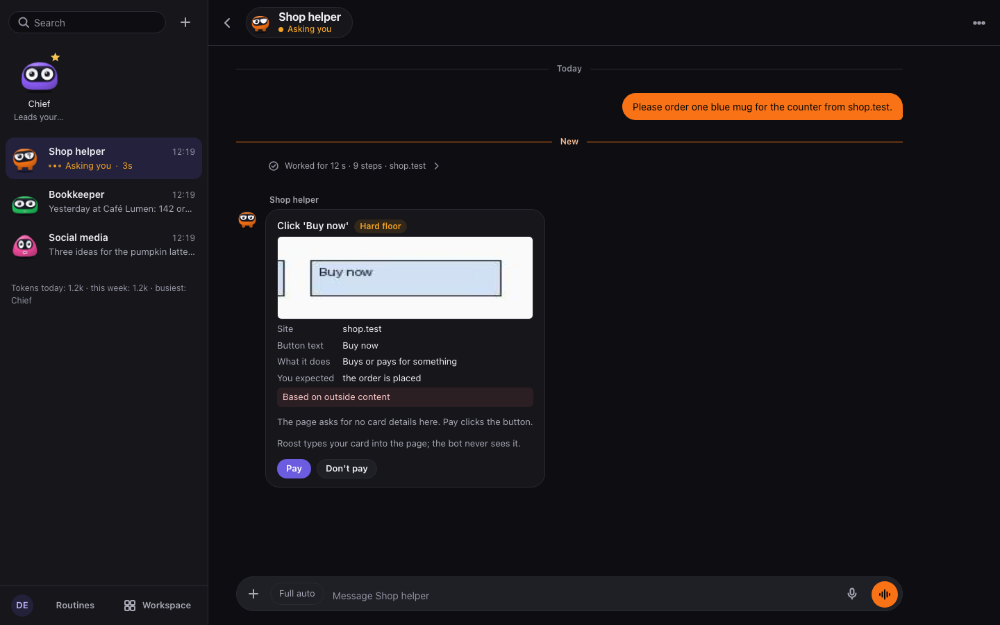
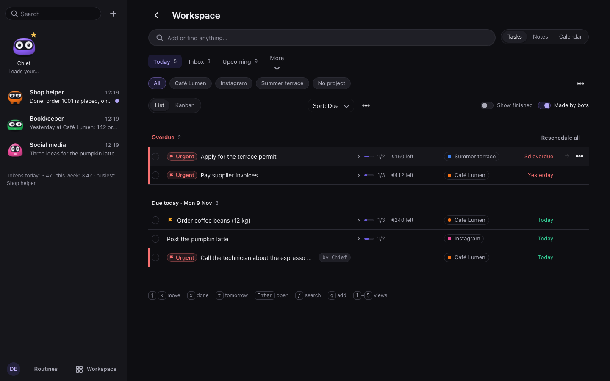
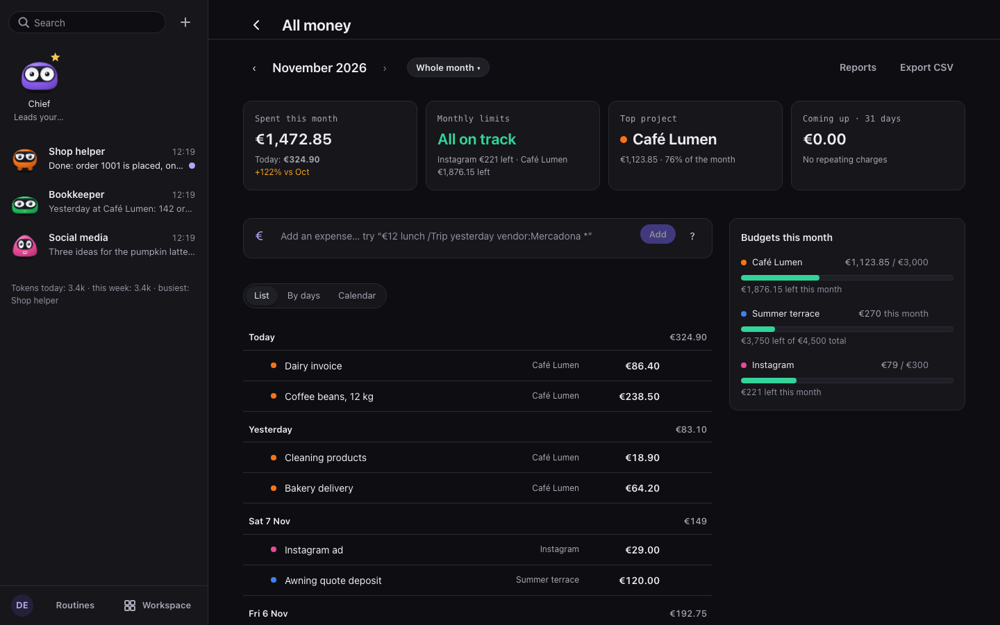
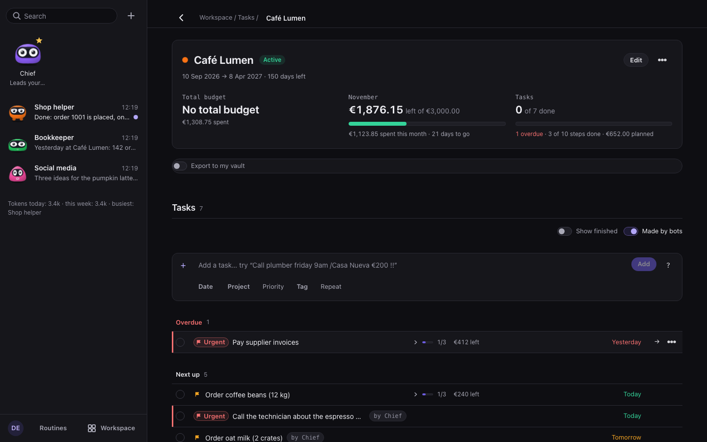
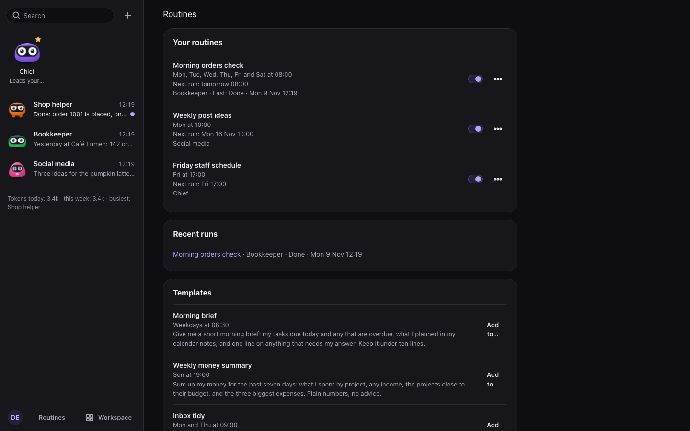
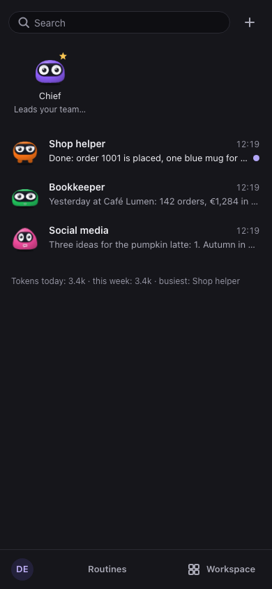
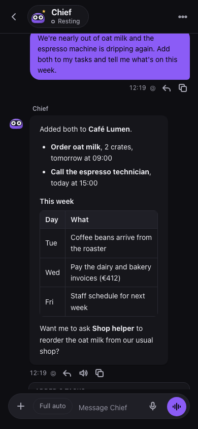
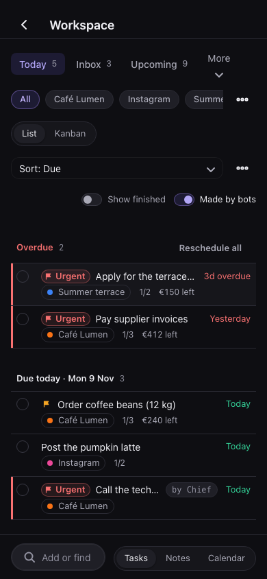

# Roost

**A personal AI team for anyone with a Claude subscription. Each bot gets its own computer.**

Roost runs on your own Mac. You chat with a few AI bots: a main bot, plus any you create, such as a shop helper, a
bookkeeper or a social media bot. Each bot has its own small Linux computer with a browser, so it can actually *do*
things: look up suppliers, fill in forms, check your orders, keep your tasks and money in order, and report back.
Every click that spends money, sends a message or deletes something waits for your **Yes**.

> **Status: public beta, version 2.0.0-beta.** Roost is used every day by its author, but it is young. Expect rough
> edges, read the [limits](#known-limits) below, and please open an issue when something breaks.



## Why Roost exists

High-end AI assistants are built for big companies with engineers and budgets. A small café, bar, shop or
one-person business has the same paperwork, ordering, scheduling and online chores, and nobody to set up an AI stack
for them.

Roost aims to be the opposite of that: **one install on a Mac you already own, your existing Claude subscription, no
cloud of ours, no per-seat fees**. You talk to it in plain words, on your computer or your phone, and it keeps your
data encrypted at rest on your own disk.

## What it does today

- **Chat with a team of bots.** One endless chat per bot, with memory ("About you" plus each bot's own), replies in
  Markdown, voice in and out, pictures, tapbacks, and messages you can send while a bot is busy.
- **Each bot has a computer.** A sealed Linux container with Chromium, a live screen you can watch, and **Take
  control** when you want to do a step yourself (a sign-in, a captcha). The bot looks, clicks, types and scrolls one
  step at a time.
- **You stay in charge.** Buying, sending, submitting, deleting and account changes always stop on an **Ask card**
  with a picture of the button. **Yes** clicks only that same button. Three approval modes per bot: *Ask every
  time*, *Auto-edit* and *Review first*.
- **Vault.** Passwords and payment cards are stored sealed. When a bot needs to sign in or pay, Roost types them into
  the page itself after your Yes, and the model never sees them.
- **Your records on one Board.** Tasks (steps, reminders, repeats, Kanban and Calendar), money (expenses, income,
  budgets per project), notes and documents (docs, sheets, PDFs). Quick add understands plain lines such as
  `order coffee beans tomorrow 10:00 #Cafe €80 !high`, in English and Spanish.
- **Routines.** "Every morning at 08:00, check yesterday's orders": a bot works on a schedule while you are away and
  sends you a Report. A routine can also watch a page and run only when it changes.
- **Skills.** Saved how-tos every bot can reuse. Bots can propose one, and only your **Save skill** keeps it.
- **Your Mac folders**, if you grant one, with a diff and Undo on every change. **Connectors** to a service's HTTP
  API with your key, which is sealed and never shown to the model.
- **Phone app** (Android, Flutter) over [Tailscale](https://tailscale.com/), with notifications, and tasks that keep
  working offline and sync when the Mac is back.
- **Token usage** per bot, per day and per kind, so you can see where your limit goes.

| | |
|---|---|
|  |  |
|  |  |
|  |  |

<p align="center">
  
  
  
</p>

A short demo: [docs/screenshots/demo.webm](docs/screenshots/demo.webm). More detail on what bots do and what always asks: [the user guide](docs/user-guide.md).

## How it works

```
 Browser / phone ──► Gateway (FastAPI, 127.0.0.1:18800, Docker) ──► Claude (your subscription, via the Claude Agent SDK)
                          │
                          └─► Desk keeper (127.0.0.1:18801, signed requests)
                                 ├─ each bot's Linux computer (Chromium, its own network, egress proxy)
                                 └─ each bot's workspace container (sealed, for programs)
```

- Every listener binds `127.0.0.1` only. The phone reaches the Mac through Tailscale (`tailscale serve`), never the
  open internet.
- User content is encrypted at rest (AES-GCM, a per-user key). The server holds the key, so this is **not**
  end-to-end encryption. Real end-to-end encryption is on the roadmap.
- Web pages always reach the model as untrusted data. A gate checks every tool call, and some rules (the *hard
  floor*) ask in every mode.

## Quick start

You need: a Mac (Apple Silicon), [Docker Desktop](https://www.docker.com/products/docker-desktop/),
[uv](https://docs.astral.sh/uv/), Node 20+, and a Claude subscription (Pro or Max).

```bash
git clone https://github.com/Bsh13lder/Roost.git && cd Roost
uv sync
make deploy          # builds the images, starts the gateway (Docker) and the desk keeper (launchd)
make claude-login    # signs the gateway in to your Claude subscription, once
```

Open <http://127.0.0.1:18800> and create your account. The first account is the only one this install has.

Day to day: `make logs`, `make rebuild` after changing gateway code, `make down` / `make up`.
For the phone, see [`docs/plans/2026-10-23-roost-app-restructure.md`](docs/plans/2026-10-23-roost-app-restructure.md)
(Tailscale) and [`mobile/`](mobile/).

## Known limits

- **macOS only** for now: the desk keeper and the voice service run on the Mac.
- **Claude only** for now: Roost uses the Claude Agent SDK with your subscription.
- **One account per install.** Your time zone is detected from your browser and can be changed in Settings.
- The phone app is Android only, and is installed from your own Mac.
- Bot computers are containers on your Mac, not separate machines.
- It is a beta: back up `~/Roost/data` (Roost also backs up the database before each schema change).

## Roadmap

- **More model providers** through their APIs (OpenAI-compatible, local models), not just Claude.
- **Run on a server**: the whole stack in Docker on a VPS or a small office box, so a business can share one Roost.
- **An open Skill hub**: share and install skills ("reconcile the day's till", "post this week's menu").
- **Ready-made bots for small businesses**: café, bar, shop, freelancer.
- More languages, iOS, and real end-to-end encryption.

Ideas and help are welcome. Open an issue first for anything big.

## Development

```bash
uv run pytest            # Python unit and integration tests (scripted model, fake desk; never a real LLM)
cd web && npm test       # web unit tests (vitest)
cd mobile && flutter test
make e2e                 # Playwright end-to-end tests against a scripted gateway
node scripts/readme-shots.mjs   # regenerates the screenshots in docs/screenshots/
```

The design spec is [`docs/specs/2026-10-12-roost-design.md`](docs/specs/2026-10-12-roost-design.md), and each feature's
plan is in [`docs/plans/`](docs/plans/). [`CLAUDE.md`](CLAUDE.md) holds the rules the codebase follows.

## Built with Claude Code

Roost was designed by its author and written with [Claude Code](https://claude.com/claude-code), Anthropic's coding
agent, across many long sessions: planning, test-first code, reviews and security reviews. The author's verdict: the
best model they have worked with, for any kind of work.

## License

[MIT](LICENSE) © 2026 BlckIt. Third-party code and assets are listed in
[`THIRD_PARTY_NOTICES.md`](THIRD_PARTY_NOTICES.md).
